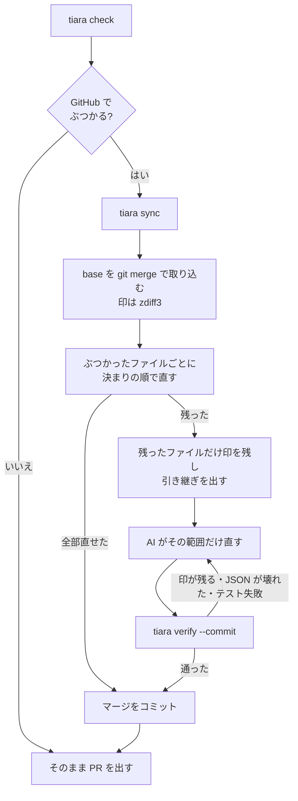

# tiara の仕組みと設計

[README](../README.ja.md) は使い方です。ここでは、中で何をしているか、なぜそうしたかを書きます。

## 1. 何のための道具か

AI を何人も並べて1つのリポジトリで動かすと、PR がぶつかる回数が増えます。そのたびに次の往復が起きます。

1. PR を出す → GitHub が「This branch has conflicts」と出す
2. main を取り込む → AI がファイルを丸ごと読んでぶつかりの印を直す
3. push → CI をやり直す

tiara は、この往復を **PR を出す前に1回で済ませる** ための道具です。

- ぶつかるかどうかを、GitHub と同じ判定で先に知る
- 機械で決められるぶつかりは AI を使わずに直す
- 残ったぶつかりだけを、範囲と理由を付けて AI に渡す
- AI の直しを確かめてからコミットする

tiara 自身は AI を呼びません。直すのは、その場で動いている Claude Code や Codex です。

## 2. 全体の流れ

## 3. ぶつかりの予測（`check.py`・`git.py`）

### GitHub と同じ判定を使う

`git merge-tree --write-tree HEAD <base>` を使います。GitHub が PR のマージを試すときと同じ ort マージで、**作業ツリーにも index にも触りません**。git 2.38 以上が要ります。

出力から、ぶつかったファイルごとに次の3つの中身（index の stage）を取り出します。

| stage | 中身 |
|---|---|
| 1 | 共通の祖先（分岐した時点） |
| 2 | 自分のブランチ（PR） |
| 3 | base（main） |

この3つを「直す決まり」（5章）に通して、ファイルごとに次のどれかに分けます。

- `auto`：tiara が直せる
- `regenerate`：生成物なので base 側を残し、あとで作り直す
- `AGENT`：AI が要る

### ほかの開いている PR とのぶつかり（`check --prs`）

`gh pr list` で、同じ base に向いている開いている PR を取得します。それぞれについて次のように調べます。

1. その PR の先頭を `refs/tiara/pr/<番号>` に取ってくる（`git fetch origin pull/<番号>/head`）
2. base にその PR を混ぜた姿を、作業ツリーを使わずに作る（`merge-tree` で木を作り、`commit-tree` で一時的なコミットにする）
3. その姿と自分のブランチを `merge-tree` で比べる

「#212 が先に入ったら、この3ファイルがぶつかる」がわかるので、マージの順番を決める材料になります。今の base とすでにぶつかっているファイルは重ねて出しません。

## 4. 取り込みと直し（`sync.py`）

1. 安全の確認：コミットしていない変更がある、またはマージの途中なら止まります。
2. 必要なときだけ動く：base がもう入っている、または GitHub がそのままマージできるなら、何もしません（`--always` で取り込みだけすることもできます）。
3. 取り込み：`git -c merge.conflictStyle=zdiff3 merge --no-ff --no-commit <base>`。ふつうの git のマージなので、`git merge --abort` でいつでも戻せます。
4. ファイルごとに直す：index に残ったぶつかり（`git ls-files -u`）の stage 1・2・3 を「直す決まり」に通します。
5. 直せたファイル：結果を `git hash-object` で保存し、`git update-index` で index に入れ、`git checkout-index` で作業ツリーに書きます。git を通して書くので、改行の変換（autocrlf）や `.gitattributes` の設定が効きます。
6. 全部直せたら、何をどう直したかを書いたメッセージでマージをコミットします。
7. 残ったら、残ったファイルにだけ git の印を残し、引き継ぎ（6章）を出して止まります。

## 5. 直す決まり（`resolve.py`・`merge3.py`・`structured.py`）

上から順に試し、最初にうまくいったものを使います。どの決まりも、**迷ったら推測せずに止めて AI に渡す**ようにしています。

| 順 | 決まり | 何をするか | 止めるとき |
|---|---|---|---|
| 0 | `regenerate` | 設定の glob に合うファイル（生成物）は混ぜず、base 側を残す。あとで作り直すよう伝える | 設定が無ければ使わない |
| 1 | `line` | 自前の行の3方向マージ。git とぶつかりの切れ目が違い、混ぜられることがある | 両側の変更が重なる・接する |
| 2 | `insert-both` | ぶつかりがすべて「元の行を消さずに、同じ場所へ両方が足しただけ」なら、base 側、続けて自分の側の順に両方残す。片方がもう片方を含むなら大きいほう | 両方が同じ名前（`def`・`class`・`func`・`function`・`struct`・`let`・キーの `x:` や `x =` など）を定義している。設定 `insert_both: false` |
| 3 | `structured` | JSON・YAML を値として読み、辞書はキーごと、リストは `id`・`name`・`key`・`slug`（または設定 `id_rules`）で要素を見分けて混ぜる。名札が無いリストは、両方が末尾に足しただけなら両方残す | 同じ値を別々に変えた。片方が消し、もう片方が変えた |

それ以外はすべて AI に渡します。具体的には、同じ行を別々に変えた、片方が消してもう片方が変えた、両方が別の中身で同じファイルを足した、バイナリ、の場合です。

### 構造マージの細かい決まり

- 行マージが通っても、構造でぶつかるなら「ぶつかり」にします。行の境目でリストの要素がくっついて1つ消える、という事故を防ぐためです。
- JSON は、触っていない部分の元の文字列をそのまま写します。書き方（1行のオブジェクト、字下げ）が崩れません。書き出したものは読み直して、値が同じか確かめます。
- 型まで比べます（`true` と `1` は別）。
- YAML は PyYAML があるときだけ扱います。コメントがある YAML は、書き出すとコメントが消えるので書き出しません。行マージの結果が構造マージと同じ値になるときだけ、行マージの結果を使います。

### insert-both の順番を「base 側が先」にした理由

すでに main に入っているものを動かさず、自分の追加を後ろに置く形は、人が手で取り込むときの多くのやり方と同じだからです。順番に意味があるコード（初期化の順など）では、`insert_both: false` にします。

## 6. AI への引き継ぎ

残ったファイルごとに、次のことを出します（`.git/tiara/handoff.md` にも保存）。

- ぶつかりの印がある行の範囲（AI がファイル全体を読まずに済む）
- なぜ残ったか（同じ行を変えた、JSON の同じ値、など。JSON ならその場所 `$.a.b`）
- base 側と自分の側で、そのファイルを変えたコミットの件名（両側の意図）
- 両方が同じ行を書き換えていれば、「両方の意図が両立しないなら、黙ってどちらかを選ばずに人に聞く」という注意
- 終わらせ方（`tiara verify --commit`）とやめ方（`git merge --abort`）

印は zdiff3 形式（`<<<<<<<` 自分の側、`|||||||` 共通の祖先、`=======`、`>>>>>>>` base 側）です。祖先が見えるので、AI が「それぞれ何を変えたか」を読み取りやすくなります。

## 7. 確かめて終わらせる（`verify`）

1. 引き継いだファイルに、ぶつかりの印が残っていないか
2. JSON・YAML が読めるか
3. 引き継いだファイルだけを `git add` し、ほかにまだぶつかっているファイルが無いか
4. `--cmd` があればテストを流す
5. `--commit` があれば、tiara が直したものと AI が直したものを書いたメッセージでマージをコミットする

問題があれば何もコミットせず、何が残っているかを出します（終了コード 3）。

## 8. 設定（`config.py`）

リポジトリの直下の `.tiara.json`。どのキーも省略できます。知らないキーがあるとエラーにします（書き間違いに気づくため）。

| キー | 既定 | 意味 |
|---|---|---|
| `base` | `origin/main` | PR の向き先 |
| `regenerate` | なし | 生成物の glob。混ぜずに base 側を残す |
| `id_rules` | なし | JSON・YAML のリストの要素を、場所ごとにどのキーで見分けるか |
| `insert_both` | `true` | 「両方が足しただけ」を両方残すか |

## 9. 安全のための決まり

- tiara は AI を呼ばず、API キーも要りません。ネットワークを使うのは `git fetch` と `gh pr list` だけです（`--no-fetch` で fetch もしない）。
- `check` は何も変えません。作業ツリー・index・ブランチは元のままです（`--prs` のときだけ `refs/tiara/pr/*` を作ります）。
- `sync` は、コミットしていない変更があると動きません。ふつうの `git merge` を使うので、`git merge --abort` で必ず戻せます。
- push はしません。push するのは、使う人か AI です。
- 決まりはどれも、迷ったら止めて AI に渡します。止まったぶつかりを、黙って片方に寄せることはしません。

## 10. ファイルの地図

| ファイル | 役目 |
|---|---|
| `src/tiara/cli.py` | `tiara` コマンド（check・sync・verify・handoff） |
| `src/tiara/git.py` | git の呼び出し（merge-tree、stage の読み取り、index への書き込み） |
| `src/tiara/check.py` | ぶつかりの予測と、ほかの開いている PR との重ね合わせ |
| `src/tiara/sync.py` | 取り込み、直し、引き継ぎ、verify |
| `src/tiara/resolve.py` | 直す決まりの順番（regenerate・line・insert-both・structured） |
| `src/tiara/merge3.py` | 行の3方向マージ |
| `src/tiara/structured.py` | JSON・YAML の構造マージ（JSON の書き方を保つ） |
| `src/tiara/config.py` | `.tiara.json` |
| `integrations/claude-code/skills/tiara/SKILL.md` | Claude Code 用の skill |
| `integrations/codex/AGENTS.md` | Codex 用の `AGENTS.md` の例 |
| `tests/` | テスト（一時的な git リポジトリを作って、実際に merge・sync・verify する） |

## 11. できないこと・これから

- 同じ行を両側が別々に変えたぶつかりは直しません。AI か人が決めます。
- 「先に片方の PR に入れておけばぶつからない」という直しの案（足した塊を、ぶつからない場所へ移す、など）はまだ出しません。
- `check --prs` は、ほかの PR を1本ずつ重ねます。全部の順番の組み合わせは調べません。
- Python・Swift・JavaScript などの一般的な書き方の名前しか見分けません。ほかの言語では、同じものを両方が定義していても気づかないことがあります（その場合は `insert_both: false`）。
- GitHub 以外（GitLab など）の開いている PR の取得には、まだ対応していません（予測と sync 自体は git だけで動きます）。
